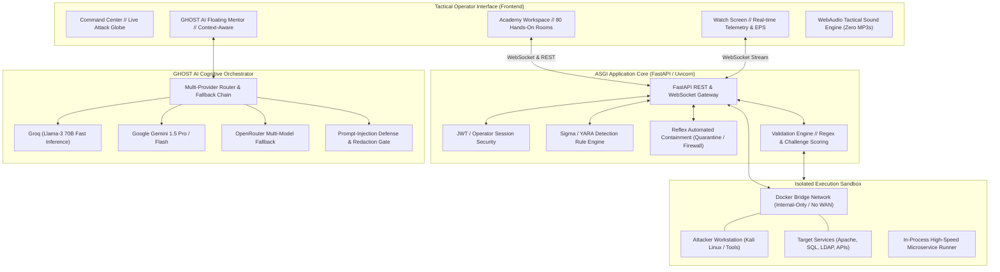

# NO ENTRY // CYBERSECURITY TRAINING ACADEMY & ADVERSARY SIMULATION PLATFORM

<div align="center">

```
  _  _  ____    ____  _  _  ____  ____  _  _ 
 ( \( )/ ___)  (  __)( \( )(_  _)(  _ \( \/ )
  )  ( \___ \   ) _)  )  (   )(   )   / )  / 
 (_)\_)(____/  (____)(_)\_) (__) (__\_)(__/  
```

**Next-Generation Cyber Range, Detection Engineering Sandbox & 80-Room Hands-On Academy**

[](https://www.python.org/)
[](https://fastapi.tiangolo.com/)
[](https://www.docker.com/)
[](#the-80-room-canonical-curriculum)
[](https://attack.mitre.org/)
[](LICENSE)

*“We break in, so no one else can.”*

[⚡ Watch 60s Live Attack Demo](#60-second-live-cyber-attack-demo) • [🎓 Explore 80 Rooms](#the-80-room-canonical-curriculum) • [🚀 Quickstart](#quickstart-guide) • [🧠 GHOST AI Mentor](#ghost-ai-cognitive-mentor) • [🛡️ Architecture](#platform-architecture)

</div>

---

## 🌟 Executive Overview

**NO ENTRY** is an enterprise-grade, portfolio-ready cybersecurity training platform and live-fire simulation range. Engineered from the ground up for modern offensive, defensive, and detection engineers, NO ENTRY pairs **80 fully realized hands-on practice rooms** with an isolated zero-trust sandbox engine, real-time WebSockets telemetry, synthesized WebAudio soundscapes, and an adaptive multi-provider AI mentor (**GHOST**).

Every task is practical: operators audit real vulnerability vectors, inspect authentic network PCAPs, query Sysmon event logs, craft Sigma detection rules, and emulate adversary tactics inside ephemeral, network-isolated Docker containers or in-process microservice emulators.

---

## 📐 Platform Architecture



---

## ⚡ 60-Second Live Cyber Attack Demo

Experience a complete, scripted, safe cyber engagement in 60 seconds with scrubbable controls, an interactive network topology diagram, and a synchronized dual-terminal display:

- **Attacker Workstation (Left Stream)**: Interactive shell showing weaponization, exploitation payloads, privilege escalation, and lateral movement.
- **SOC SIEM Telemetry (Right Stream)**: Live Sysmon Event ID 1/3, Suricata IDS alerts, Sigma rule detections, and analyst triage steps.
- **Topology Map**: Real-time packet traversal animations through Perimeter Firewall, DMZ Web Server, Internal Domain Controller, and SIEM Correlation Engine.

```
Stage 1: Reconnaissance (T1595.001)        --> Inbound SYN scan against 10.10.14.90
Stage 2: Initial Foothold (T1190)          --> Remote Code Execution on debug API
Stage 3: Local Discovery (T1082 / T1059)   --> Architecture & SUID binary audit
Stage 4: Privilege Escalation (T1548.001)  --> SUID PATH hijack to Root; shadow dumped
Stage 5: Telemetry Correlation (T1046)     --> 12 sensor events linked into incident tree
Stage 6: Automated SIEM Alerting (Sigma)   --> Rule 'proc_creation_lnx_suid_privesc' matches
Stage 7: Analyst Triage & Verification     --> True-Positive verdict & containment dispatch
Stage 8: Zero-Trust Containment (SOAR)     --> Firewall IP block, host quarantine, PIR ready
```

*Launch directly from the web interface at `/watch?demo=1` or via the Tactical Command Palette (`/` -> `DEMO`).*

---

## 🎓 The 80-Room Canonical Curriculum

The academy is divided into four 20-room professional tracks covering the complete cybersecurity lifecycle. Every room features an everyday analogy, technical breakdown, practical demonstration, hands-on tasks, and live terminal interaction:

| Track | Identifiers | Rooms | Core Competencies |
| :--- | :--- | :---: | :--- |
| **🔴 Red Team** | `red-01` to `red-20` | **20 / 20** | Reconnaissance, Port Scanning, Web Vulnerabilities, SQL Injection, XSS, IDOR, File Inclusion, SUID PrivEsc, Active Directory Kerberoasting, Post-Exploitation Capstone. |
| **🔵 Blue Team** | `blue-01` to `blue-20` | **20 / 20** | SOC Foundations, Windows Event Logs (EVTX), Linux Syslog, Wireshark PCAP Analysis, SIEM Correlation, YARA Malware Scanning, Phishing Analysis, Threat Hunting, IR Playbooks. |
| **🟣 Purple Team** | `purple-01` to `purple-20` | **20 / 20** | Adversary Emulation, MITRE ATT&CK Mapping, Atomic Red Team, Detection Gap Analysis, Living off the Land (LOLBins), Cloud Telemetry, Continuous Purple Pipeline. |
| **🟢 Detection Eng** | `detect-01` to `detect-20` | **20 / 20** | Sigma & YARA Authoring, Detection-as-Code (DaC), CI/CD Gating & Unit Testing, Log Ingestion Pipelines, Tuning & False Positive Reduction, Automated Containment SOAR. |
| **TOTAL** | **4 Tracks** | **80 / 80** | **100% Operational & Verified** |

### Red Team (Offensive Operations // 20 Rooms)
1. `red-01`: Cybersecurity Fundamentals & Threat Landscape
2. `red-02`: Linux Command Line & System Administration
3. `red-03`: Networking Protocols & Packet Architecture
4. `red-04`: Passive & Active Reconnaissance
5. `red-05`: Network Mapping & Vulnerability Scanning
6. `red-06`: Service Enumeration & Fingerprinting
7. `red-07`: Vulnerability Assessment & CVE Analysis
8. `red-08`: Web Application Security Fundamentals
9. `red-09`: SQL Injection (SQLi) Exploitation
10. `red-10`: Cross-Site Scripting (XSS)
11. `red-11`: Broken Authentication & Session Hijacking
12. `red-12`: Broken Access Control & IDOR
13. `red-13`: File Upload Vulnerabilities & Webshells
14. `red-14`: Command Injection & Remote Code Execution
15. `red-15`: Directory Traversal & Local File Inclusion (LFI)
16. `red-16`: Password Cracking & Credential Attacks
17. `red-17`: Linux Privilege Escalation (SUID, Sudo, Capabilities)
18. `red-18`: Active Directory Fundamentals & Kerberoasting
19. `red-19`: Lateral Movement & Post-Exploitation
20. `red-20`: Offensive Operations Capstone Challenge

### Blue Team (Defensive Operations & SOC // 20 Rooms)
1. `blue-01`: SOC Operations & Security Fundamentals
2. `blue-02`: Windows Security Architecture & Event Logs
3. `blue-03`: Linux Security Architecture & Log Analysis
4. `blue-04`: Network Security Monitoring & Traffic Analysis
5. `blue-05`: Wireshark Deep Packet Inspection
6. `blue-06`: Enterprise Log Analysis & Aggregation
7. `blue-07`: SIEM Operations & SPL/KQL Fundamentals
8. `blue-08`: Advanced Windows Event Log Forensics
9. `blue-09`: Brute-Force & Credential Attack Detection
10. `blue-10`: Malware Analysis Fundamentals & YARA
11. `blue-11`: Phishing Email Investigation & Header Analysis
12. `blue-12`: Endpoint Detection & Response (EDR) Operations
13. `blue-13`: Network Anomaly Detection & Threat Hunting
14. `blue-14`: Threat Hunting Workflows & Hypotheses
15. `blue-15`: Digital Forensics & Artifact Acquisition
16. `blue-16`: Memory Forensics with Volatility
17. `blue-17`: Incident Response Lifecycles (NIST / SANS)
18. `blue-18`: Security Orchestration, Automation & Response (SOAR)
19. `blue-19`: Cloud Security Monitoring (AWS / Azure)
20. `blue-20`: Defensive Operations Capstone Challenge

### Purple Team (Adversary Emulation & Convergence // 20 Rooms)
1. `purple-01`: Purple Teaming Philosophy & Collaboration
2. `purple-02`: MITRE ATT&CK Framework Implementation
3. `purple-03`: Atomic Red Team Execution & Validation
4. `purple-04`: Emulation Planning & Threat Intelligence
5. `purple-05`: Telemetry Gap Analysis & Sensor Coverage
6. `purple-06`: Initial Access Emulation & Detection Validation
7. `purple-07`: Execution Technique Emulation & Detection
8. `purple-08`: Persistence Emulation & Detection
9. `purple-09`: Privilege Escalation Emulation & Detection
10. `purple-10`: Defense Evasion Emulation & Detection
11. `purple-11`: Credential Access Emulation & Detection
12. `purple-12`: Discovery & Lateral Movement Emulation
13. `purple-13`: Command & Control (C2) Emulation & Detection
14. `purple-14`: Exfiltration & Impact Emulation
15. `purple-15`: Living off the Land (LOLBins) Emulation
16. `purple-16`: Advanced Ransomware Scenario Emulation
17. `purple-17`: Cloud Threat Emulation & Multi-Cloud Defense
18. `purple-18`: CI/CD Pipeline & Supply Chain Attack Emulation
19. `purple-19`: Threat Informed Defense & Coverage Scoring
20. `purple-20`: Purple Team Capstone Exercise

### Detection Engineering (Detection-as-Code // 20 Rooms)
1. `detect-01`: Detection Engineering Philosophy & Lifecycle
2. `detect-02`: Understanding Telemetry & Log Ingestion
3. `detect-03`: Sigma Rules Fundamentals & Authoring
4. `detect-04`: YARA Rules for File & Memory Detection
5. `detect-05`: Snort & Suricata Network Signatures
6. `detect-06`: EDR Query Languages & Telemetry
7. `detect-07`: Detection Testing with Atomic Attacks
8. `detect-08`: False Positive Reduction & Tuning
9. `detect-09`: Detection-as-Code (DaC) & GitOps Pipelines
10. `detect-10`: Behavior-Based Detection vs Signatures
11. `detect-11`: Cloud-Native Detection Engineering
12. `detect-12`: Identity & Access Detection Engineering
13. `detect-13`: Network Anomaly & Beaconing Detection
14. `detect-14`: Memory & Process Injection Detection
15. `detect-15`: Supply Chain & Build Pipeline Detection
16. `detect-16`: Living-off-the-Land (LOLBAS) Detection
17. `detect-17`: Metrics, SLIs & Detection Health Monitoring
18. `detect-18`: Threat-Informed Detection Gap Analysis
19. `detect-19`: Automation & SOAR Integration for Detections
20. `detect-20`: Detection Engineering Capstone Exercise

---

## 🧠 GHOST AI Cognitive Mentor

NO ENTRY features **GHOST**, an autonomous, context-aware cybersecurity mentor embedded into every training room:

- **Multi-Provider Priority Routing**: Automatically cascades from `Groq` (ultra-fast inference) to `Google Gemini` to `OpenRouter`, with local mission-scripted fallbacks when offline.
- **Context-Aware Assistance**: GHOST inspects your current room ID, completed steps, raw terminal telemetry, and active Sigma rule syntax to provide tailored nudges without giving away raw answers.
- **Safety Gate & Injection Defense**: Built-in prompt injection neutralization, secret scrubbing, and token rate limiting protect the application from evasion attacks.
- **Audio Synthesis**: Supported by Deepgram text-to-speech for audible mission briefings and voice guidance.

---

## 🚀 Quickstart Guide

### Option 1: Local Python Environment (Recommended for Development)

```bash
# 1. Clone the repository
git clone https://github.com/your-org/no-entry.git
cd no-entry

# 2. Create and activate a Python 3.11 virtual environment
python -m venv .venv
# On Windows:
.venv\Scripts\activate
# On Linux/macOS:
source .venv/bin/activate

# 3. Install dependencies
pip install -r requirements.txt

# 4. Copy environment configuration
cp .env.example .env

# 5. Launch development server
python -m uvicorn backend.app.main:app --host 127.0.0.1 --port 8000 --reload
```

Open your browser to `http://127.0.0.1:8000` to enter the Command Center, or `http://127.0.0.1:8000/academy` to start training.

### Option 2: Docker Container Deployment

```bash
# Build production Docker image
docker build -t no-entry:latest .

# Run container on port 8000
docker run -d --name no-entry-app -p 8000:8000 no-entry:latest

# Check container health status
curl http://127.0.0.1:8000/api/health
```

---

## 🧪 Testing & Verification

NO ENTRY includes an automated test suite verifying room schemas, curriculum integrity, task scoring, validator correctness, and API endpoints:

```bash
# Run full non-Docker regression test suite (279+ automated tests)
pytest backend/tests/ -k "not docker" -v

# Run targeted academy curriculum test
pytest backend/tests/test_academy_api.py -v

# Run detection engineering test suite
pytest backend/tests/test_rooms_detection_17_20.py -v
```

---

## 🎮 Easter Eggs & Tactical Hotkeys

- **Keyboard Shortcut `/`**: Opens the Tactical Command Palette from anywhere in the platform.
- **Konami Code (`↑ ↑ ↓ ↓ ← → ← → B A`)**: Unlocks `[RETRO RUNNER]` mode, applying a 1980s CRT scanline and phosphor glow filter to the interface.
- **Terminal Command `matrix`**: Cascades green digital rain directly in the xterm.js workstation.
- **Terminal Command `ghost --whoami`**: Intercepts an encrypted status transmission from the GHOST AI sentinel node.
- **Terminal Command `ne --stats`**: Outputs a live operational audit across all 80 rooms and active sensors.

---

## 🔒 Ethics & Responsible Disclosure

NO ENTRY is designed exclusively for educational, ethical research, and defensive readiness purposes. All simulated attack scenarios, reverse shells, and exploit vectors are confined strictly to local containerized bridges or software emulators. Never execute unauthorized penetration tests against systems you do not own.

---

## 📄 License

Distributed under the MIT License. See [LICENSE](LICENSE) for more information.
