<div align="center">

<a href="https://no-entry.onrender.com">
  
</a>

<br>

[](https://no-entry.onrender.com)
[](#academy)
[](#launch)
[](#stack)
[](#modes)

**[BRIEFING](#briefing)** · **[CAPABILITIES](#capabilities)** · **[ATTACK REPLAY](#replay)** · **[ACADEMY](#academy)** · **[FOOTAGE](#footage)** · **[ARCHITECTURE](#architecture)** · **[GHOST AI](#ghost)** · **[LAUNCH](#launch)** · **[SECURITY](#security)**

<br>


<br><br>


</div>

<br>

<a id="briefing"></a>
<div align="center"></div>

### What is NO ENTRY?

**NO ENTRY is a cybersecurity training ground that runs in your browser.**

You get a virtual attacker workstation, a set of vulnerable practice targets, and a simulated Security Operations Center (SOC), all sealed inside an isolated lab. You attack something, then you *watch the defenders' screen light up* as your own actions generate alerts, logs and detections. Then you write the rule that would have caught you.

Most platforms teach attack **or** defence. NO ENTRY puts both on the same screen so you can see how one causes the other.

| | |
|---|---|
| 🟥 **Break in** | Run controlled attacks from a Kali-style operator terminal against isolated targets. |
| 🟦 **Watch it happen** | See the telemetry, alerts and MITRE ATT&CK techniques your attack just produced. |
| 🟩 **Shut it down** | Investigate, write Sigma / YARA detections, and trigger containment. |
| 🤖 **Never stuck** | **GHOST**, an AI mentor, knows which room you are in and what you just typed. |

> [!IMPORTANT]
> Everything happens **inside the lab or the built-in emulator**. NO ENTRY is not a tool for attacking real systems. See [Rules of Engagement](#rules).

<details>
<summary><b>🧠 New to security? Quick glossary</b></summary>

<br>

| Term | Plain-English meaning |
|---|---|
| **Red team** | The "attackers". They try to break in, to find weaknesses before real criminals do. |
| **Blue team** | The "defenders". They monitor, detect and respond to attacks. |
| **Purple team** | Red and blue working together so every attack teaches a defence. |
| **SOC** | Security Operations Center: the team (and screens) that watch for threats around the clock. |
| **SIEM** | A system that collects logs from everywhere and raises alerts when something looks wrong. |
| **MITRE ATT&CK** | A public catalogue of how real attackers behave, each technique has an ID like `T1110` (brute force). |
| **Sigma / YARA** | Rule formats for describing "what suspicious looks like" in logs (Sigma) and files (YARA). |
| **Detection-as-Code** | Treating detection rules like software: version-controlled, tested and automatically validated. |

</details>

### The NO ENTRY loop

Every room follows the same five-beat rhythm:

<div align="center"></div>

<br>

<a id="capabilities"></a>
<div align="center"></div>

### Everything inside the range

<div align="center">
<a href="NO-ENTRY-readme-kit/NO-ENTRY-readme-kit/docs/screenshots/command-center.png">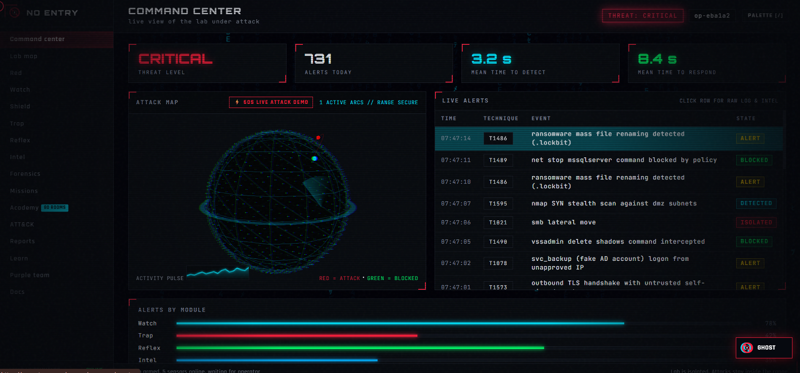</a>
<br><sub><b>Command Center</b> · live threat level, alert stream, mean time to detect / respond, and a 60-second live attack demo</sub>
</div>

<br>

| Module | What it does |
|---|---|
| 🎛️ **Command Center** | One cinematic control room: navigation, live stats, alert feed and the tactical command palette (`/`). |
| 🧪 **Cyber Range engine** | Disposable attacker + target environments with private networking, resource limits and automatic cleanup. |
| 💻 **Operator Workstation** | A full-screen browser terminal (xterm.js over WebSocket) with quick-probe commands, mission briefing, hints and live lab status. |
| 🗺️ **Lab Map** | Interactive 3D range topology. Select a host, see its OS, zone and last detection, run a web-breach scenario, isolate a host. |
| 🟥 **Red** | Scenario-driven offensive console: web app breach, ransomware simulation, credential attack, insider threat. |
| 👁️ **Watch** | The SOC view: event streams, alert triage, ATT&CK technique visibility and a threat-hunting query interface. |
| 🛡️ **Shield** | Hardening posture: checklist of controls with a before/after audit score. |
| 🪤 **Trap** | Deception: honeypots, decoy credentials and canary tokens that trip when touched. |
| 🔎 **Intel** | IOC enrichment and a campaign relationship graph. |
| 🟪 **Purple Team** | Attacker terminal and SIEM/SOAR logs, correlated side by side, step by step. |
| 🧬 **Detection Engineering** | Sigma, YARA, Sysmon, Suricata, log normalization, tuning, testing and CI/CD validation. |
| 🤖 **GHOST AI** | Context-aware mentor with a safe offline fallback. |
| 🏆 **Progression** | Task validation, XP, room completion, next-mission unlocks, per-operator tracking. |

<br>

<a id="replay"></a>
<div align="center"></div>

### 60 seconds. 8 stages. Both sides of the screen.

Press **WATCH A LIVE ATTACK** and NO ENTRY plays a scripted replay of a full intrusion. Attacker terminal on one side, SOC telemetry on the other, an animated network topology in the middle.

<div align="center"></div>

<div align="center"></div>

<br>

<div align="center">
<a href="NO-ENTRY-readme-kit/NO-ENTRY-readme-kit/docs/screenshots/purple-team.png">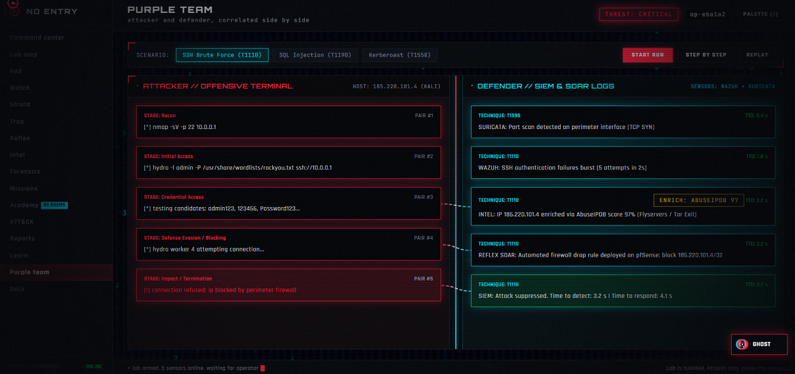</a>
<br><sub><b>Purple Team</b> · an SSH brute force (<code>T1110</code>) on the left, the SIEM catching it and SOAR blocking the IP on the right. Time to detect: 3.2 s.</sub>
</div>

> [!NOTE]
> The replay is a **scripted educational animation**, not an attack on any real network.

<br>

<a id="academy"></a>
<div align="center"></div>

### 80 practical rooms across four tracks

<div align="center"></div>

<br>

Every room teaches in the same **eight steps**, so you always know where you are:

| # | Step | # | Step |
|:-:|---|:-:|---|
| 1 | **What is this?** | 5 | **Technical explanation** |
| 2 | **Everyday analogy** | 6 | **Real-world impact** |
| 3 | **Architecture flow diagram** | 7 | **What to observe in the lab** |
| 4 | **How it works** | 8 | **Common mistakes & key takeaway** |

Then you open the terminal and *do it*. Tasks are validated automatically, XP is awarded, and the next room unlocks.

<div align="center">
<a href="NO-ENTRY-readme-kit/NO-ENTRY-readme-kit/docs/screenshots/academy.png">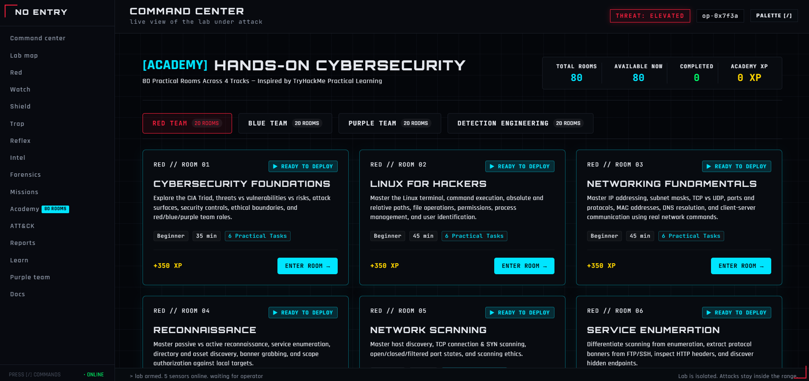</a>
<br><sub><b>The Academy</b> · 80 rooms, four tracks, XP and progress tracking</sub>
<br><br>
<a href="NO-ENTRY-readme-kit/NO-ENTRY-readme-kit/docs/screenshots/room-briefing.png">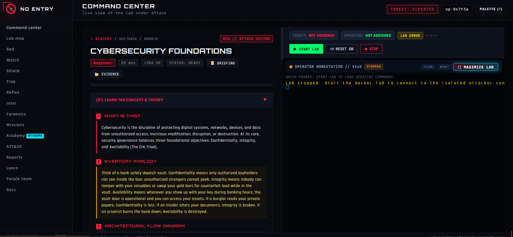</a>
<br><sub><b>Inside a room</b> · theory on the left, live lab on the right</sub>
</div>

<br>

<a id="footage"></a>
<div align="center"></div>

<div align="center"></div>

<br>

<div align="center">
<a href="NO-ENTRY-readme-kit/NO-ENTRY-readme-kit/docs/screenshots/operator-workstation.png">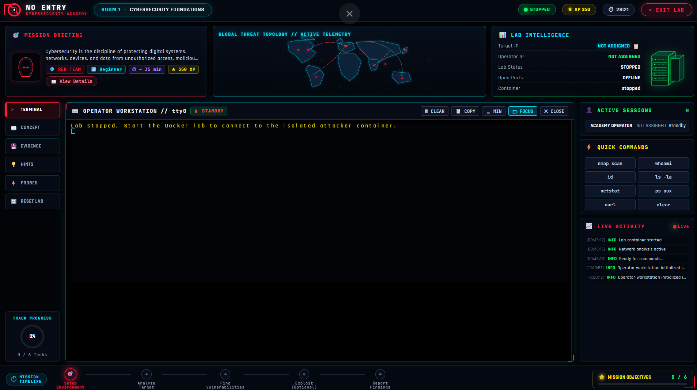</a>
<br><sub><b>Operator Workstation</b> · full-screen terminal, mission briefing, lab intelligence, quick commands and mission timeline</sub>
</div>

<br>

<table>
<tr>
<td width="50%" align="center"><a href="NO-ENTRY-readme-kit/NO-ENTRY-readme-kit/docs/screenshots/landing.png">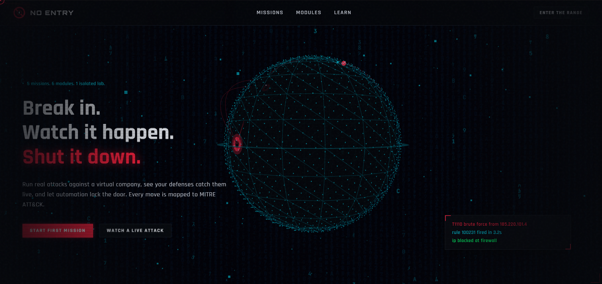</a><br><sub><b>Landing</b></sub></td>
<td width="50%" align="center"><a href="NO-ENTRY-readme-kit/NO-ENTRY-readme-kit/docs/screenshots/access-terminal.png">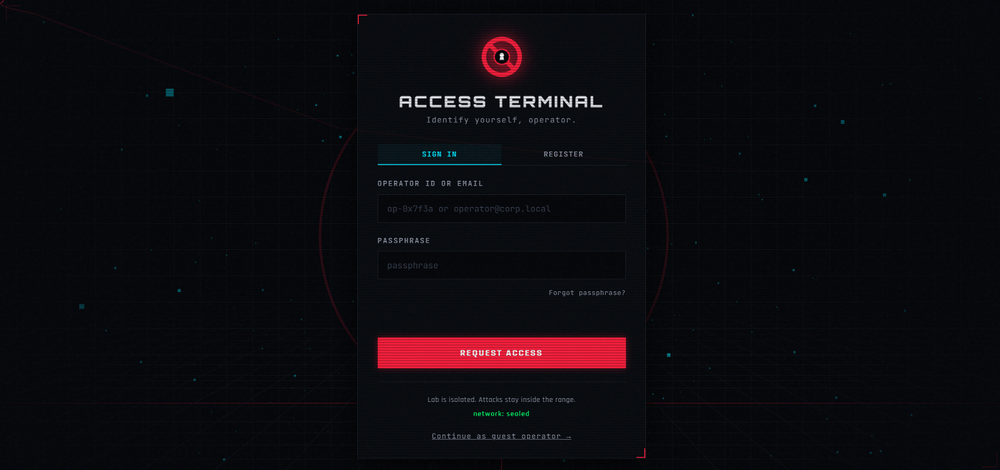</a><br><sub><b>Access Terminal</b> · operator sign-in</sub></td>
</tr>
<tr>
<td align="center"><a href="NO-ENTRY-readme-kit/NO-ENTRY-readme-kit/docs/screenshots/lab-map.png">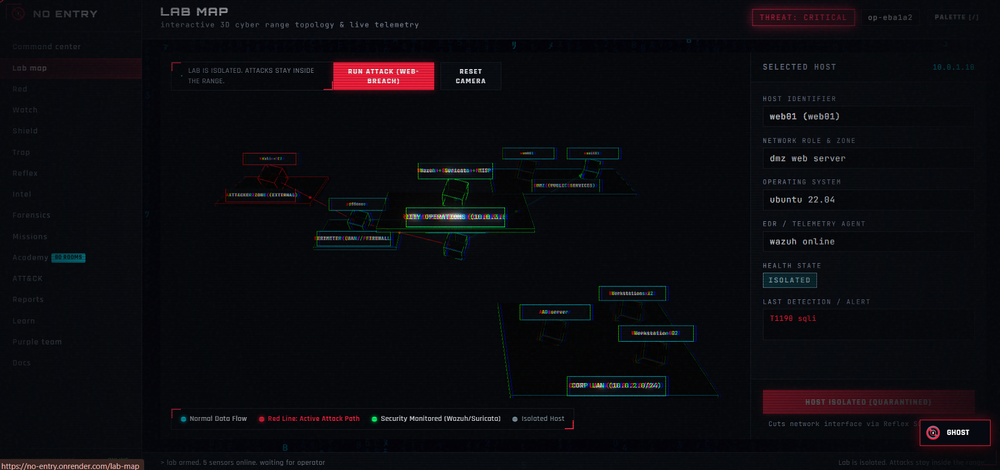</a><br><sub><b>Lab Map</b> · 3D range topology</sub></td>
<td align="center"><a href="NO-ENTRY-readme-kit/NO-ENTRY-readme-kit/docs/screenshots/red-team-ops.png">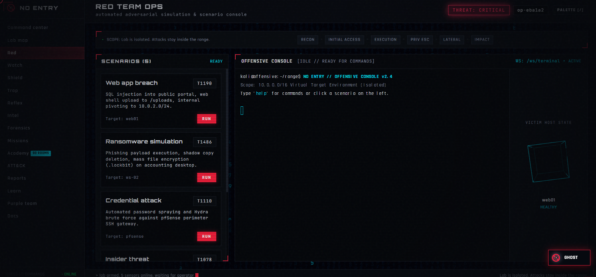</a><br><sub><b>Red Team Ops</b> · scenarios and offensive console</sub></td>
</tr>
<tr>
<td align="center"><a href="NO-ENTRY-readme-kit/NO-ENTRY-readme-kit/docs/screenshots/shield-defense.png">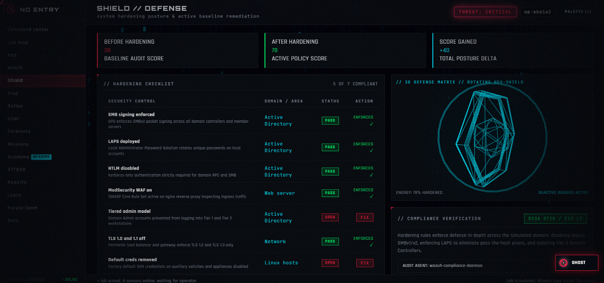</a><br><sub><b>Shield</b> · hardening checklist, score 38 → 78</sub></td>
<td align="center"><a href="NO-ENTRY-readme-kit/NO-ENTRY-readme-kit/docs/screenshots/trap-deception.png">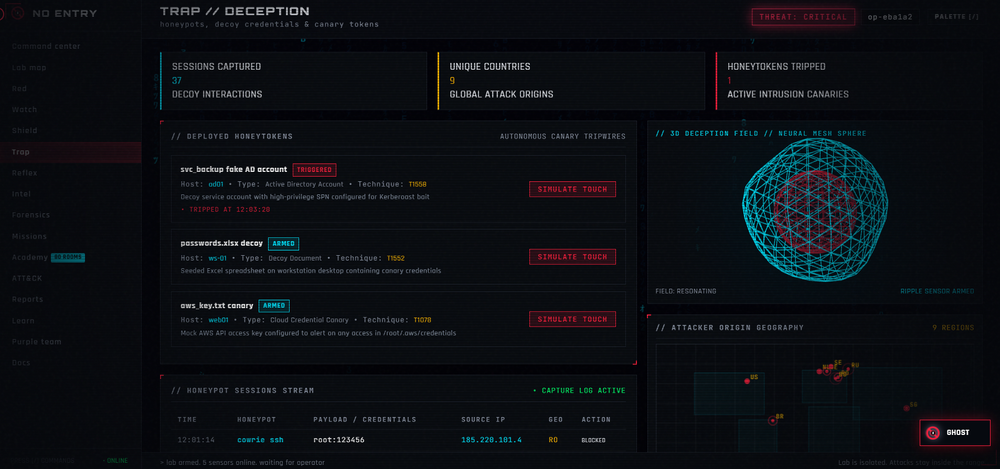</a><br><sub><b>Trap</b> · honeypots and canary tokens</sub></td>
</tr>
<tr>
<td align="center"><a href="NO-ENTRY-readme-kit/NO-ENTRY-readme-kit/docs/screenshots/intel-threat-recon.png">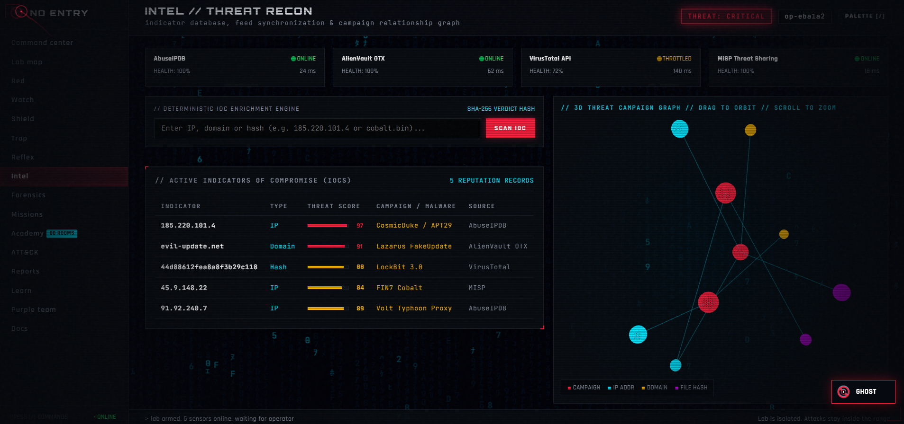</a><br><sub><b>Intel</b> · IOC enrichment and campaign graph</sub></td>
<td align="center"><a href="NO-ENTRY-readme-kit/NO-ENTRY-readme-kit/docs/screenshots/attack-coverage-heatmap.png">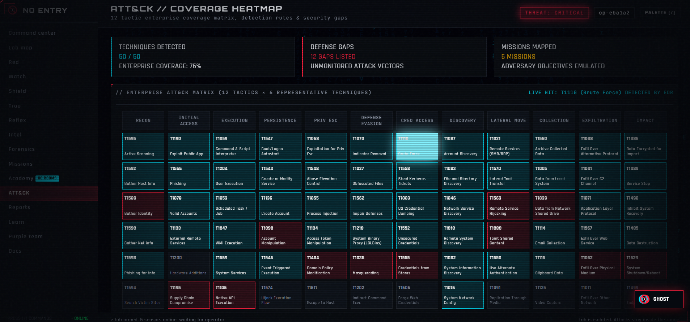</a><br><sub><b>ATT&amp;CK Heatmap</b> · 12 tactics, detection gaps</sub></td>
</tr>
</table>

<br>

<a id="architecture"></a>
<div align="center"></div>

### Five layers, each swappable

<div align="center"></div>

<br>

**What happens when you run a command:**

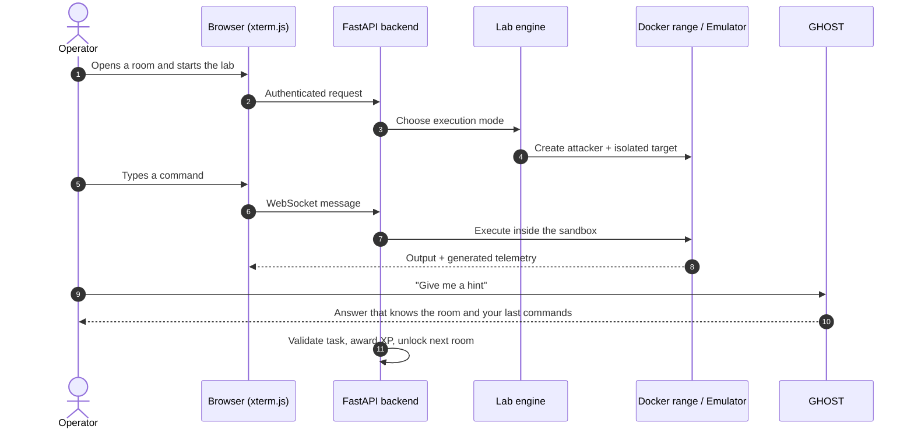

<br>

<a id="ghost"></a>
<div align="center"></div>

### A mentor that knows where you are

GHOST is not a generic chatbot. Before it answers, it looks at **your current room, your task progress, your recent terminal activity and any Sigma rule you are working on**, then routes the question to the best available AI provider.

<div align="center"></div>

<br>

<table>
<tr>
<td width="62%" valign="top">

**Quick actions:** `HINT` · `EXPLAIN THIS LOG` · `WHY DID IT WORK` · `REVIEW MY RULE`

**Providers:** Groq · Google Gemini · OpenRouter, with configurable routing and fallback.

**Voice:** Deepgram speech-to-text / text-to-speech for audible mission briefings.

**Safety:** prompt-injection defences, learner input treated as untrusted, secret redaction, token and rate limits.

**Offline-safe:** with no AI keys configured, GHOST drops to a deterministic, curriculum-based hint engine. It stays useful, but it is *not* equivalent to a live LLM.

</td>
<td width="38%" align="center">

<a href="NO-ENTRY-readme-kit/NO-ENTRY-readme-kit/docs/screenshots/ghost-mentor.png">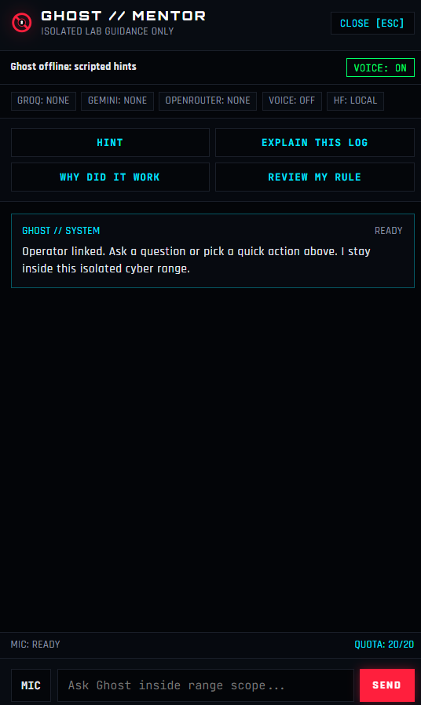</a>

</td>
</tr>
</table>

<br>

<a id="modes"></a>
<div align="center"></div>

NO ENTRY picks how to run a lab based on where it is hosted. Be clear about which one you are using:

| | 🐳 **Full Cyber Range** | 🧩 **Emulation Fallback** |
|---|---|---|
| **Engine** | Docker runner | `ProcessLabRunner` |
| **What runs** | Real attacker and target **containers** | Supported commands, scans and challenges **simulated in memory** |
| **Needs** | Linux host / VM with Docker Engine access | Nothing special, works on managed PaaS |
| **Networking** | Private Docker bridge, no public target ports | n/a |
| **Persistent shell** | ✅ | Emulated |
| **Best for** | Self-hosting the real thing | Public demos, quick tours |

> [!NOTE]
> The public demo at **[no-entry.onrender.com](https://no-entry.onrender.com)** runs in **emulation mode** on a free Render instance. It is not a full public Docker range, and the free tier has resource and filesystem limits, so SQLite progress there should not be treated as permanent.

<br>

<a id="launch"></a>
<div align="center"></div>

```bash
# 1 · clone
git clone https://github.com/chethankp365/NO-ENTRY.git
cd NO-ENTRY

# 2 · environment
python -m venv .venv
source .venv/bin/activate          # Windows: .venv\Scripts\activate
pip install -r requirements.txt

# 3 · configure (all AI / voice keys are optional)
cp .env.example .env

# 4 · launch
python -m uvicorn backend.app.main:app --reload
```

Open **http://127.0.0.1:8000** and request access. You can also *continue as guest operator*.

<!-- VERIFY BEFORE PUBLISHING: confirm the requirements file name, .env.example, and the uvicorn module path (app.main:app) match the repository. -->

**Want the real Docker range?** Run on a Linux host with Docker Engine. NO ENTRY detects the daemon and uses containers automatically; without it, it falls back to emulation.

```bash
docker build -t no-entry .
docker run -p 8000:8000 no-entry
```

**Run the test suite**

```bash
pytest
```

> Latest production-readiness report: **295 passed · 106 skipped · 0 failed**. Most skipped tests need a live Docker daemon.

<details>
<summary><b>🔑 Optional AI and voice keys</b></summary>

<br>

GHOST works without any keys using its scripted fallback. To enable live AI, add keys for any of **Groq**, **Google Gemini** or **OpenRouter**; add a **Deepgram** key for voice. Put them in `.env` and never commit that file.

</details>

<br>

<a id="security"></a>
<div align="center"></div>

NO ENTRY runs offensive exercises, so isolation is a design requirement, not an afterthought.

| Safeguard | Detail |
|---|---|
| 🔐 **Authenticated labs** | Lab lifecycle operations require login, and sessions belong to the operator who started them. |
| 🧱 **Sealed network** | Attacker and target talk only over a private, internal-only Docker bridge. |
| 🚫 **No exposed targets** | Vulnerable containers publish no host ports. |
| 👤 **Least privilege** | Non-root attacker container, `no-new-privileges`. |
| 📉 **Resource caps** | CPU, memory and PID limits on every container. |
| 🧹 **Auto cleanup** | Session-scoped lifecycle and teardown. |
| 🙅 **No host access** | No Docker socket or host filesystem mounted into learner containers. |
| 🛡️ **Account hygiene** | bcrypt password hashing, JWT auth, HTTP-only cookies, rate-limited auth endpoints. |
| 🤖 **Safe AI** | Prompt-injection defences and secret redaction in GHOST. |

The app **manages** lab lifecycles. It does not run learner commands directly on the host operating system.

<br>

<a id="stack"></a>
<div align="center"></div>

<div align="center">


</div>

| Area | Technologies |
|---|---|
| **Backend** | Python, FastAPI, Uvicorn |
| **Frontend** | HTML, CSS, JavaScript ES modules, Jinja2, SVG, WebAudio |
| **Terminal & realtime** | xterm.js, WebSockets |
| **Auth** | JWT, bcrypt |
| **Database** | SQLite (default), PostgreSQL (optional) |
| **Cyber range** | Docker, private bridge networks |
| **AI & voice** | Groq, Gemini, OpenRouter, Deepgram |
| **Detection** | Sigma, YARA concepts and validation |
| **Quality** | Pytest |
| **Deploy** | Dockerfile, Render |

<br>

<a id="rules"></a>
<div align="center"></div>

NO ENTRY is for **ethical education, authorised security research and defensive readiness.**

- ✅ Practise inside the lab, the emulator, or systems **you own**.
- ✅ Get **written permission** before testing anything else.
- ❌ Never use these techniques against systems you are not authorised to test.

<br>

<div align="center">


<br>

**[▶ Launch the live demo](https://no-entry.onrender.com)** · **[⭐ Star the repo](https://github.com/chethankp365/NO-ENTRY)**

<sub>Built by <a href="https://github.com/chethankp365">@chethankp365</a></sub>

</div>
